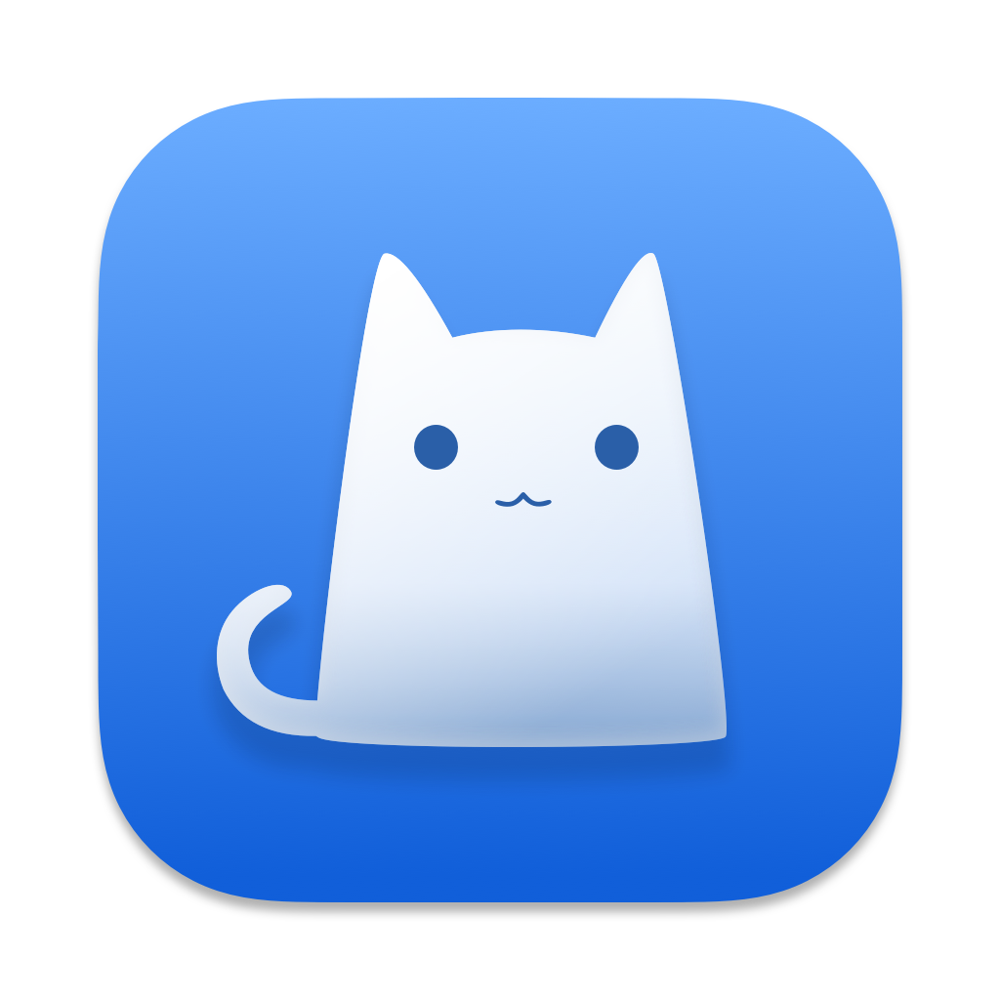

<p align="center">

</p>
<h1 align="center">ClashX Go</h1>

**English** | [简体中文](README.zh-CN.md)

A macOS menu bar proxy client modeled closely on [ClashX](https://github.com/yichengchen/clashX)
and [ClashX Meta](https://github.com/MetaCubeX/ClashX.Meta), built in Go with
[MyGo](https://mygo.egoist.dev) and powered by [mihomo](https://github.com/MetaCubeX/mihomo).

ClashX Go aims to feel like the original: a native menu bar menu with policy
groups, node latency badges and live speeds, plus a ClashX-style preferences
window — but with a single self-contained `.app` that bundles the core and
needs no runtime download.

## Features

**Menu bar, ClashX style**

- UI in Simplified Chinese or English (follows the system language; `CLASHX_GO_LANG=en` forces English), the menu bar is fully localized
- Native tray menu: outbound mode, policy groups with per-node latency
  badges (`✅ / ⚠️ / ❌`), node switching, latency tests, config management
- Two-line live speed in the menu bar (`↑ / ↓`), fixed width so it never
  jitters; the whole item dims while neither system proxy nor TUN is active
- Custom icon (menu bar), interchangeable with a custom
  `menuImage.png` in the config folder

**Proxy control**

- System proxy without a privileged helper, with the user's previous proxy
  configuration snapshotted and restored on disable/quit
- TUN mode: a one-time administrator authorization installs a setuid copy of
  the core, after which toggling TUN is a passwordless hot API call
- Tun DNS: optionally point system DNS at a chosen address while TUN is on
  (originals restored when TUN turns off or the app quits); empty uses local
  DNS
- Per-app routing: pick `.app` bundles in the 分流 tab to force them direct or
  through the proxy before domain rules (PROCESS-NAME plus a bundle-path
  regex, so helper processes match too); works with TUN and system proxy
- Automatic pause on selected Wi-Fi SSIDs, auto-restart of a stopped core,
  and automatic controller-port shifting when the configured port is busy

**Config management**

- Managed subscriptions (add / update / delete, rename by provider title,
  quota and expiry shown in the menu) and local config files
- Subscriptions that are full Clash configs keep their **own policy groups,
  rules and DNS**; provider-style node lists get a generated config
- Restart-free live reload; edits to the active config file are picked up
  automatically; remembered node selections are replayed after each reload

**Preferences (ClashX semantics)**

- Six tabs: 通用 / 连接 / 分流 / 全局快捷键 / 调试 / Meta
- General: launch at login, notifications, IPv6, ports, API secret,
  allow-LAN, latency-test URL, Wi-Fi suspend list, proxy bypass list
- Global hotkeys for proxy/TUN, mode switching, copy command, open menu/log/
  dashboard (accelerated via MyGo's global shortcut module)
- Built-in dashboard: mihomo's `external-ui` serves zashboard at `/ui`

**Diagnostics and notices**

- **连接** tab: live connections with the matched rule, proxy chain and
  traffic, search, close-all and a per-connection detail dialog, plus the
  loaded rules in matching order
- Redacted diagnostics bundle (versions, ports, system proxy, listeners and
  log tails) from 调试 → 导出诊断包
- A daily notice when the subscription quota drops below 5% or expires
  within 72 hours (silenced by 减少通知)
- An update check shortly after launch; the notice opens the installer

## Requirements

- macOS 11 or later (Apple Silicon or Intel; build with
  `-platform darwin/universal` for one app that runs natively on both)
- Go 1.27+ to build; the MyGo CLI is declared as a Go tool (`go tool mygo`)
- `curl` and `gunzip` to fetch the bundled cores at build time

## Install

Download `ClashX Go <version>.dmg` from the
[Releases page](https://github.com/Sakurasan/ClashX-go/releases), open it and
drag `ClashX Go.app` into `Applications`.

The app is ad-hoc signed (no Developer ID), so the first launch may be
blocked by Gatekeeper: right-click the app → **Open**, or allow it in
**System Settings → Privacy & Security**.

## Build from source

Fetch the mihomo core for both architectures first, then build the app:

```sh
scripts/fetch-cores.sh                  # mihomo v1.19.32 for arm64 + amd64
scripts/build-dnshelper.sh              # universal Tun DNS helper
go tool mygo build                      # -> build/darwin-<arch>/ClashX Go.app + .dmg
go tool mygo build -platform darwin/universal   # universal app + universal core
```

Fetch the dashboard too (zashboard, served at `/ui`). MyGo bundles
`resources/dashboard` into the app; on first launch the app copies it into
the config folder so mihomo's `external-ui` can serve it. CI does this
automatically.

For day-to-day development:

```sh
go tool mygo dev        # live-reload development build
go build . && ./clashx-go   # plain binary; needs resources/darwin-<arch>/mihomo
go test ./... && go vet ./...
```

> Note: macOS login items (开机启动) require a real `.app` bundle, so that
> switch only works in a MyGo build, not in a plain development binary.

## Auto-build and updates

GitHub Actions (`.github/workflows/build.yml`) runs `go vet`, `go tool mygo
vet` and the tests, then builds the universal `.app` on every push and pull
request. Pushing a `v*` tag publishes the DMG (and signed update manifests
once configured) as a GitHub release. Every push to `main` also refreshes a
rolling **Nightly** prerelease; it is unsigned and never the *latest*
release, so the stable update feed ignores it.

Self-updates use MyGo's signed updater:

1. `go tool mygo keygen` — writes `mygo-update.key` (secret) and
   `mygo-update.pub`.
2. Put the public key in `mygo.json`:
   `"updates": { "publicKey": "…", "github": "<owner>/<repo>" }`.
3. Add the private key as the repository secret `MYGO_UPDATER_PRIVATE_KEY`.
4. Bump `version` in `mygo.json`, add a `## <version>` section to
   `CHANGELOG.md` (it becomes the update notes), and tag `vX.Y.Z`; the
   workflow publishes the signed feed.

The menu's **帮助 → 检查更新…** then checks the newest tagged release, shows
the notes and installs + relaunches. Builds without the `updates` block say
so instead of failing silently.

## Usage

1. Launch the app — the cat appears in the menu bar and the core starts
   automatically.
2. Open the menu → **配置** → **托管配置 → 管理…** to add a subscription, or
   pick a local YAML config from the list.
3. Turn on **系统代理** or **Tun 模式** from the menu; the menu bar icon
   becomes solid while a proxy path is active.
4. **更多设置 → 偏好设置…** opens the settings window (`⌘,`).

### Files

Everything lives in `~/.config/clashx-go/`, kept separate from ClashX
Meta's `~/.config/clash.meta/`:

| File | Purpose |
| --- | --- |
| `app.json` | app settings, profiles and remembered node selections |
| `sub-*.yaml` | downloaded subscriptions |
| `running.yaml` | config actually pushed to the core (ports/TUN overlaid) |
| `config.yaml` | generated config for provider-style subscriptions |
| `core.log` | mihomo stdout/stderr |
| `dashboard/` or `ui/` | optional web dashboard served at `/ui` |

## How it works

- The core binary ships inside the app bundle. On first launch it is copied
  to the config folder; nothing is downloaded at runtime.
- The core boots with a minimal **bootstrap config** (endpoints, TUN, a
  DIRECT catch-all) and the full config is pushed over `PUT /configs` right
  after the controller answers — startup is ~200 ms and live reloads happen
  in the background while old routing keeps serving.
- Runtime state (`/configs`, `/proxies`, `/traffic`) is polled/streamed and
  coalesced into one state snapshot consumed by the tray menu and settings
  window.
- TUN uses a one-time `osascript`-authorized setuid copy of the core
  (`/Library/Application Support/clashx-go/mihomo`); no helper daemon and no
  password on later toggles.

## Project layout

```
main.go              app lifecycle, tray, settings window, core orchestration
menu.go              ClashX-style tray menu (groups, proxies, configs, help)
panel.go             settings window shell, tabs and panes
settings.go          settings model, persistence, 通用 pane
shortcuts.go         global hotkey registry
about.go             About window
profiles.go          managed subscriptions
manage.go, subdlg.go subscription manager / add dialog
systemproxy_*.go     system proxy snapshot, apply and restore (macOS/other)
tray_speed.go        menu bar bitmap: icon + two-line speed
core/
  core.go            process manager: bundled core, bootstrap config, TUN
  config.go          config generation/overlay
  client.go          mihomo REST client
  controller.go      state polling and traffic streaming
scripts/             core and dashboard fetchers
assets/              app icon and menu bar cat (embedded)
```

## Credits

- [ClashX](https://github.com/yichengchen/clashX) and
  [ClashX Meta](https://github.com/MetaCubeX/ClashX.Meta) by west2online and
  contributors — UI, behavior and icon assets this project is modeled on
- [mihomo](https://github.com/MetaCubeX/mihomo) — the proxy core
- [MyGo](https://mygo.egoist.dev) by egoist — native macOS UI framework
- [uix](https://github.com/smallnest/uix) — component library
- [zashboard](https://github.com/Zephyruso/zashboard) — web dashboard

## Star History

[](https://star-history.com/#Sakurasan/ClashX-go&Date)

## License

[AGPL-3.0](LICENSE), following ClashX Meta, whose icons and design this
project reuses.
